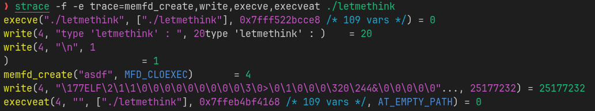
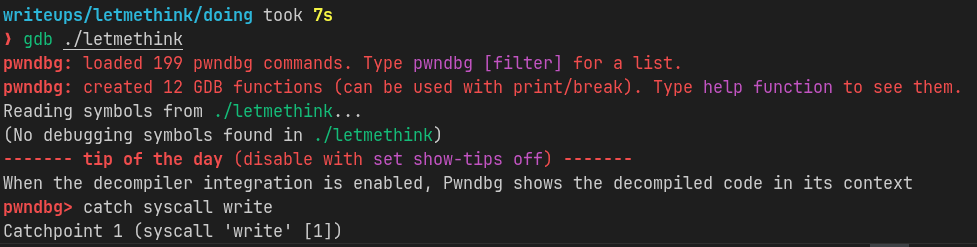
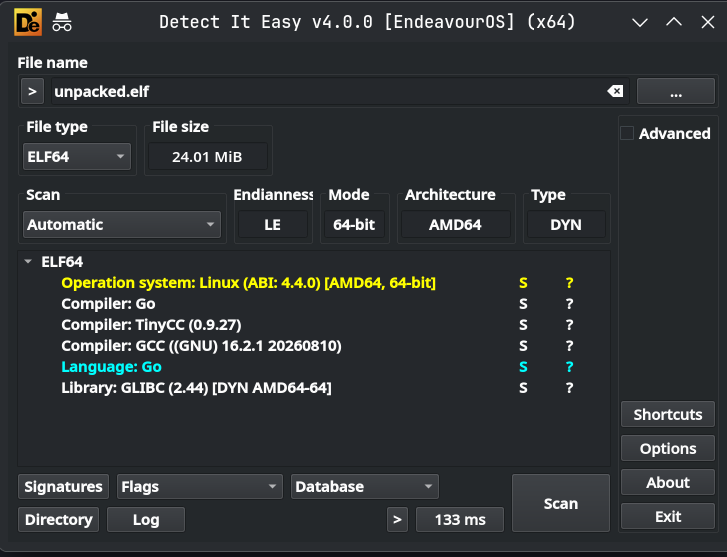
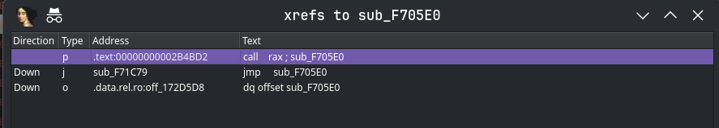
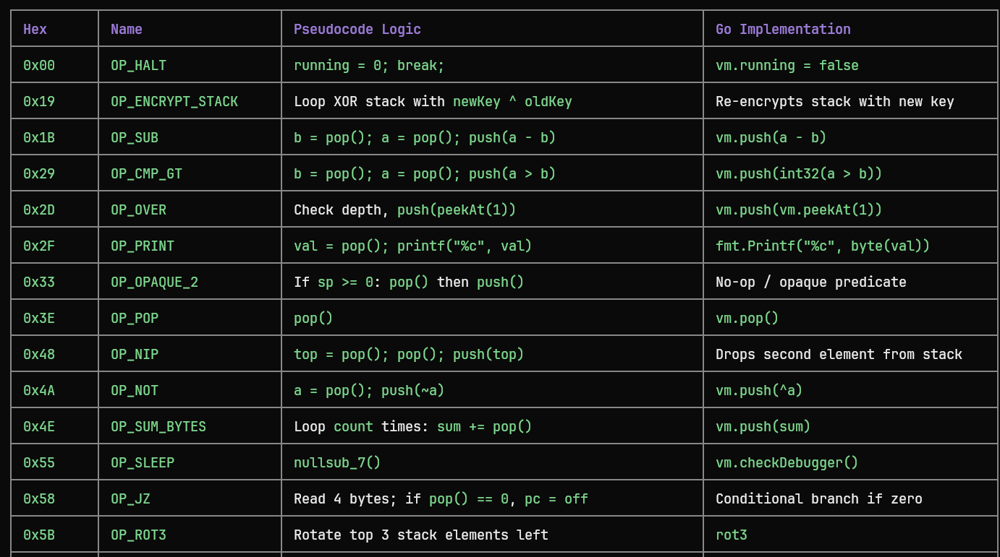
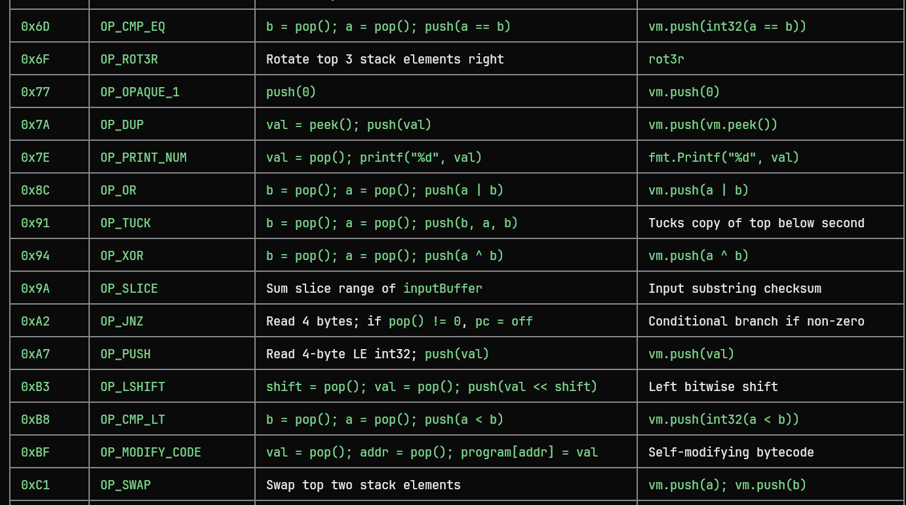
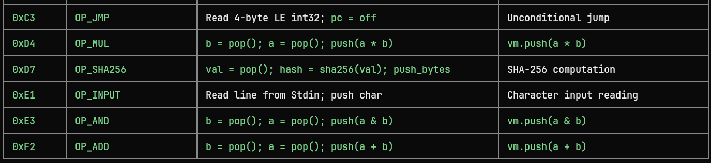

## **Challenge Name :** Revenant
### **Category :** Reverse Engineering

### **Description :**

> Just a simple ...
Wait , let me think .
>


### **𝐀𝐮𝐭𝐡𝐨𝐫 : [𝐁𝐥𝐚𝐜𝐤𝐤𝐚𝐝𝐞𝐫](https://github.com/Blackkader/)**
---

### **Files Given :** _'letmethink.zip'_

---

### Solution

We unzip and we get 1 **binary** we try to run it and it asks us to type 'letmethink' , if you type anything here , it should exit with an error . 

Next we throw it in ida and open main function : 

```c
__int64 __fastcall main(int a1, char **a2, char **a3)
{
  unsigned int v4; // eax
  .
  .
  .
  unsigned __int64 v66; // [rsp+88h] [rbp-40h]

  v66 = __readfsqword(0x28u);
  si128 = _mm_load_si128((const __m128i *)&xmmword_A20);
  v64 = _mm_load_si128((const __m128i *)&xmmword_9B0);
  v65[0] = _mm_load_si128((const __m128i *)&xmmword_AC0);
  *(__m128i *)((char *)v65 + 15) = _mm_load_si128((const __m128i *)&xmmword_A30);
  v4 = time(timer: nullptr);
  srand(seed: v4);
  v5 = sub_1DB0(unk: *a2);
  v6 = sub_1CF0(file: *a2);
  if ( v6 == -1 )
    return 1;
  v7 = v6;
  v8 = sub_1C40(unk: 3735929052LL, unk: *a2, unk: 0, unk: 0, unk: 0, unk: 0);
  v10 = v9(unk: v8);
  if ( v10 < 0 )
    return 1;
  v59 = v10;
  v12 = sub_1C40(unk: 3735929047LL, unk: 0, unk: v5, unk: 3, unk: v11, unk: v10);
  v18 = v17(unk: v12, unk: 0, unk: v13, unk: v14, unk: 2, unk: v16, unk: 0, unk: v15);
  if ( v18 == -1 )
    return 1;
  v58 = v7 + v18;
  v19 = getenv(name: "TRUSTISKEY");
  if ( !v19 )
    v19 = getpass(prompt: "type 'letmethink' : ");
  v60 = v5 - v7;
  v21 = sub_1E40(unk: v58, unk: v5 - v7, unk: v19);
  if ( v21 == 1 )
    return 1;
  for ( ; *v19; *(v19 - 1) = *((_BYTE *)&v62 + v20 + 7) )
  {
    v22 = rand();
    ++v19;
    v23 = (0x410410410410411LL * (unsigned __int128)(unsigned __int64)v22) >> 64;
    v20 = v22 - 63 * ((((unsigned __int64)(v22 - v23) >> 1) + v23) >> 5);
  }
  v24 = sub_1C40(unk: 3735929313LL, unk: "asdf", unk: 1, unk: v20, unk: 0, unk: 0);
  v27 = v26(unk: v24, unk: "asdf", unk: v25, unk: 0);
  if ( v27 < 0 )
    return 1;
  v30 = v27;
  v62 = v27;
  v31 = sub_1C40(unk: 3735929055LL, unk: v27, unk: v28, unk: v29, unk: 0, unk: 0);
  v56 = v32;
  v34 = v33(unk: v31, unk: v30, unk: v58, unk: v60);
  v35 = v56;
  if ( v60 != v34 )
  {
    return 1;
  }
  else
  {
    v61 = a2;
    v36 = 0;
    v37 = v5 - v7;
    while ( v37 > (int)v36 )
    {
      v38 = rand();
      v35 = (unsigned int)(v38 >> 31);
      LODWORD(v35) = v38 % 255;
      *(_BYTE *)(v58 + v36++) = v38 % 255;
    }
    v39 = 0;
    if ( v37 >= 0 )
      v39 = v5 - v7;
    v40 = v58 + v39;
    v41 = sub_1C40(unk: 3735929045LL, unk: v40, unk: v35, unk: 0, unk: 0, unk: 0);
    v42 = v7 - v5 + v40;
    v43(unk: v41, unk: v42, unk: v5);
    v44 = sub_1C40(unk: 3735929053LL, unk: v42, unk: 0, unk: 0, unk: 0, unk: 0);
    v46(unk: v44, unk: v59, unk: v45, unk: 0);
    v48 = sub_1C40(unk: 3735929244LL, unk: 0, unk: &unk_95C, unk: v61, unk: v47, unk: 4096);
    v49 = v62;
    v52(unk: v48, unk: v62, unk: v50, unk: v51, unk: a3);
    v53 = sub_1C40(unk: 3735929053LL, unk: v49, unk: 0, unk: 0, unk: 0, unk: 0);
    v54(unk: v53);
  }
  return v21;
}

```

Looking at this main function, it looks messy with all those weird sub_1C40 calls, but if you look closer, the pattern is pretty obvious :
First, it calculates some sizes :
- sub_1DB0 gets the total file size of argv[0].
- sub_1CF0 parses the ELF header to get the size of this stub itself.
- So v5 - v7 is literally just the size of the payload appended to the binary .
Now what is sub_1C40 with those huge numbers like 3735929052LL (0xDEADC0DC) ? 
It’s an obfuscated direct syscall dispatcher ! It xors the syscall numbers at runtime with a constant (0xDEADC0DE) to call open, mmap, memfd_create, write, munmap, and execveat without leaving standard libc imports .
Then we have this juicy part :
```c

v19 = getenv(name: "TRUSTISKEY");
if ( !v19 )
  v19 = getpass(prompt: "type 'letmethink' : ");
v60 = v5 - v7;
v21 = sub_1E40(unk: v58, unk: v5 - v7, unk: v19);
```
It takes our input string (or checks if TRUSTISKEY env var is set) and passes it to sub_1E40 along with the appended data . That's the decryption routine (RC4) . Right after decrypting , it loops and overwrites v19 with random chars from characters[] to wipe the password from memory . 
And finally :
```c
v27 = v26(unk: v24, unk: "asdf", unk: v25, unk: 0); // memfd_create("asdf")
...
v34 = v33(unk: v31, unk: v30, unk: v58, unk: v60); // write(fd, decrypted_elf, size)
...
v52(unk: v48, unk: v62, unk: v50, unk: v51, unk: a3); // execveat(fd, "", ...)

```
It creates an anonymous in-memory file with memfd_create, writes the decrypted ELF directly into that file descriptor , wipes the decrypted buffer with random bytes, and runs it using execveat !
So this whole binary is just an in-memory unpacker / loader .
Now do we need to reverse the decryption function and write an unpacker script ?
We can, but dynamic analysis is our ally here ! If the binary is decrypting the full ELF in memory and writing it into a file descriptor, we can just intercept that write syscall and grab the binary right before it executes .

Let's trace the relevant syscalls to see what's happening :





Look at that write syscall : it is writing 25177232 bytes (around 25 MB) starting with \x7fELF directly into file descriptor 4 ! The entire unpacked binary is handed to us on a silver platter in a single syscall .
Next move ? DUMP IT OUT using gdb :



Then we hit the breakpoint few times until we reach the desired write call.
In the x86_64 calling convention for syscalls :
- $rdi = fd
- $rsi = buffer pointer (where the decrypted ELF starts)
- $rdx = count (size of the buffer in bytes)

So at the right breakpoint we just dump the memory from \$rsi to \$rsi + \$rdx into a file :

```
dump memory unpacked.elf $rsi $rsi+$rdx

```
And boom we have our unpacked binary : 



Ahh it's in golang .

We try running the binary again and now it doesnt ask for letmethink input as we expected , but still crashes.

The next step is throwing the binary in ida and analyze it .

If you open a Go binary and find zero recognizable and missing string literals, it is almost certainly [Garble](https://github.com/burrowers/garble)-protected and that's our case here , so finding main.main manually is just mapping the sourcecode from the github repo to our pseudocode / assembly :

Ida shows the start function for us of course :
```
xor     ecx, ecx
lea     rdi, loc_2EABC0
call    cs:__libc_start_main_ptr
hlt
```
Presence of __libc_start_main initially suggested CGO linkage.
In the System V AMD64 ABI, rdi = first argument = the C main() wrapper that libc will call. That is our next target.

-> loc_2EABC0 to find the interesting part :

```
.text:00000000002EACDC>>>                 call    sub_2EEDC0
.text:00000000002EACE1                    mov     eax, [rsp+18h]
.text:00000000002EACE5                    mov     [rsp], eax
.text:00000000002EACE8                    mov     rax, [rsp+20h]
.text:00000000002EACED                    mov     [rsp+8], rax
.text:00000000002EACF2>>>                 call    sub_2EED80
.text:00000000002EACF7>>>                 call    sub_2EEB80
.text:00000000002EACFC>>>                 call    sub_2EECC0
.text:00000000002EAD01                    lea     rax, off_15D5E60
.text:00000000002EAD08                    push    rax
.text:00000000002EAD09>>>                 call    sub_2EED40
.text:00000000002EAD0E                    pop     rax
.text:00000000002EAD0F>>>                 call    sub_2EAD80
.text:00000000002EAD14>>>                 call    sub_2EC920
```

So we have the Call sequence identified:
    call sub_2EEDC0   ; runtime.schedinit
    call sub_2EED80   ; runtime.args
    call sub_2EEB80   ; runtime.osinit
    call sub_2EECC0   ; runtime.schedinit / initsig
    lea  rax, off_15D5E60   ; <- POINTER TO runtime.main
    push rax
    call sub_2EED40   ; runtime.newproc — spawns runtime.main goroutine
    call sub_2EAD80   ; runtime.mstart  — starts the scheduler
    call sub_2EC920   ; runtime.exit / abort (never returns)
VERIFIED AGAINST [GO SOURCE](https://github.com/golang/go/blob/master/src/runtime/proc.go) :

The bootstrap sequence comment in the source reads:
```
// The bootstrap sequence is:
//
//	call osinit
//	call schedinit
//	make & queue new G
//	call runtime·mstart
//
// The new G calls runtime·main.

```
Matches exactly.
Golden pointer: off_15D5E60 -> loc_2B47C0 (runtime.main)

-> loc_2B47C0 and we find the flow :

    call sub_2EAE40   ; doInit(runtime_inittasks)   -- runtime pkg inits
    call sub_2EE0A0   ; gcenable()                  -- enable GC
    ; loop: call sub_2C1CA0 for each module         -- doInit(m.inittasks)
    call sub_2944E0   ; main package init tasks
    call sub_2C0BE0   ; close(mainInitDoneChan)

CRITICAL FINDING from Go source:
  **main_main is called INDIRECTLY**. The source reads:

  ```
  fn := main_main // make an indirect call, as the linker doesn't know the address of the main package when laying down the runtime
fn()
```
- Located the indirect call in runtime.main:
```
.text:00000000002B4BC4                    mov     rax, cs:off_172D5D8
.text:00000000002B4BCB                    lea     rdx, off_172D5D8
.text:00000000002B4BD2>>>                 call    rax ; sub_F705E0
```
- FALSE LEAD: sub_2BE140 appeared to be main.main (called just before
  exit-flag checks). Opened xrefs showed 5 callers. Garbage .
  A garble-obfuscated main.main has exactly 1 caller (runtime.main).

- CONFIRMED sub_F705E0 = main.main:
  Xref list showed exactly 3 entries:

  This matches exactly the fn := main_main pattern from Go source.

> **NOTE:** 
> You can find the main function however you want , i just prefer this way .

Main :
```c
void __fastcall __noreturn mainfunc()
{
  __int64 v0; // rbp
  .
  .
  .
  __int64 v26; // [rsp+190h] [rbp-8h]

  if ( (unsigned __int64)&v14 <= *(_QWORD *)(v1 + 16) )
    sub_2EAFA0();
  v26 = v0;
  v25 = v2;
  if ( (unsigned __int8)sub_F7D3E0() )
  {
    (*(void (__fastcall **)(_QWORD, _QWORD, _UNKNOWN **, _QWORD, _UNKNOWN **))off_175A538[0])(
      **((unsigned __int8 **)off_175A550 + 4),
      (unsigned __int16)word_175A510,
      off_175A538[0],
      *((_QWORD *)off_175A550 + 7),
      off_175A518[0]);
    v24 = v2;
    v3 = sub_2E3E00();
    *(_QWORD *)&v24 = &unk_1687F28;
    *((_QWORD *)&v24 + 1) = v3;
    sub_530E00();
    v12 = sub_44CF00();
  }
  sub_F89AE0();
  sub_F80B20();
  sub_F91E80();
  sub_F89AE0();
  sub_F91EC0();
  sub_F89AE0();
  sub_F91EC0();
  v19 = (**(__int64 (***)(void))(*((_QWORD *)off_175A550 + 2) + 16LL))();
  v15 = 2654506009LL;
  v4 = qword_1744848;
  v17 = qword_1744848;
  if ( (unsigned __int64)qword_1744848 > 0x20 )
  {
    v6 = sub_2E7F20();
    v4 = v17;
    v5 = (_OWORD *)v6;
  }
  else
  {
    v18[0] = v2;
    v18[1] = v2;
    v5 = v18;
  }
  v13 = -21037;
  v7 = off_1744840;
  v8 = qword_1744848;
  for ( i = 0; i < v8; i = v10 + 1 )
  {
    v10 = i;
    v11 = v7[i] ^ *((_BYTE *)&v13 + i - (i & 0xFFFFFFFFFFFFFFFELL));
    if ( v10 >= v4 )
      goto LABEL_19;
    *((_BYTE *)v5 + v10) = v11;
  }
  v21 = v5;
  v20 = ((__int64 (__fastcall *)(__int64, _QWORD, _UNKNOWN **, __int64, _UNKNOWN **))*off_175A548)(
          1437662761,
          *((unsigned __int16 *)off_175A550 + 12),
          off_175A548,
          32106,
          off_175A540[0]);
  v16 = 18;
  if ( !sub_438760() )
  {
    if ( (unsigned __int8)sub_F7D3E0() )
      v12 = sub_44CF00();
    v23 = v16;
    v22 = v20;
    sub_563820();
    if ( !sub_564900() )
    {
      (**(void (__fastcall ***)(__int64, __int64, _QWORD, _QWORD, _QWORD))(*((_QWORD *)off_175A550 + 2) + 8LL))(
        0x23ACB440B490A1BBLL,
        4294967175LL,
        *(_QWORD *)(*((_QWORD *)off_175A550 + 2) + 8LL),
        (unsigned __int8)byte_175A528,
        *((_QWORD *)off_175A550 + 1));
      sub_437E80();
      sub_2E5FE0(unk: v12);
    }
    sub_2E5FE0(unk: v12);
  }
  sub_2E5FE0(unk: v12);
LABEL_19:
  sub_2ECDE0();
}

```
Basically the first IF block is **Stack Guard Check** and the second IF block is **AntiDebug Check** and it  literally translates to : 

```go
if AmIDebugged() {
		fmt.Println("wrong os version")
		os.Exit(1)

	}
```
The string is just a decoy , has nothing to do with os version .
Next called functions are decoys as well .
```c
sub_F89AE0();
sub_F80B20();
sub_F91E80();
sub_F89AE0();
sub_F91EC0();
sub_F89AE0();
sub_F91EC0();
```
Now we gonna continue explaining each part , so the writeup will be INSANELY long :

```c
v109 = (**(__int64 (***)(void))(*((_QWORD *)off_175A550 + 2) + 16LL))();
v100 = 2654506009LL;
v3 = qword_1744848;
v106 = qword_1744848;
if ( (unsigned __int64)qword_1744848 > 0x20 )
{
  v5 = sub_2E7F20(); 
  v3 = v106;
  v4 = (_OWORD *)v5;
}
else
{
  v108[0] = v1;
  v108[1] = v1;
  v4 = v108;
}
v91 = -21037; 
v6 = off_1744840;
v7 = qword_1744848;
for ( i = 0; i < v7; i = v9 + 1 )
{
  v9 = i;
  v10 = v6[i] ^ *((_BYTE *)&v91 + i - (i & 0xFFFFFFFFFFFFFFFELL));
  if ( v9 >= v3 )
    goto LABEL_214; 
  *((_BYTE *)v4 + v9) = v10;
}
v115 = v4;
```
Translates to :

```go
script := make([]byte, len(randomDat))
key2 := []byte{0xD3, 0xAD}
for i, b := range randomDat {
	script[i] = b ^ key2[i%2]
}
```
- off_1744840 / qword_1744848: embedded randomDat (//go:embed random.dat)
- -21037 in 16-bit hex is 0xADD3, meaning bytes {0xD3, 0xAD} in little-endian.
- i - (i & ~1) is bitwise equivalent to i % 2.

Next :

```c
v110 = ((__int64 (__fastcall *)(__int64, _QWORD, _UNKNOWN **, __int64, _UNKNOWN **))*off_175A548)(
         1437662761,
         *((unsigned __int16 *)off_175A550 + 12),
         off_175A548,
         32106,
         off_175A540[0]);
v101 = 18;
if ( sub_438760() ) 
{
LABEL_213:
  sub_2E5FE0(unk: v81);
LABEL_214:
  sub_2ECDE0();
}
```
Translates to :
```go
genScript := "generator.py"
if err := os.WriteFile(genScript, script, 0755); err != nil {
	panic(err)
}
- *off_175A548: Garble string decryptor reconstructing "generator.py"
- sub_438760: os.WriteFile
```

REMEMBER ! this becomes easier using dynamic analysis .

Now the second antidebug check : 
```c
if ( (unsigned __int8)sub_F7D3E0() )
  v81 = sub_44CF00();
```
Translates to

```go
if AmIDebugged() {
	os.Exit(1)
}
```
Next :

```c
v117[3] = v101;
v117[2] = v110;
sub_563820();          
if ( sub_564900() )    
{
LABEL_212:
  sub_2E5FE0(unk: v81);
  goto LABEL_213;
}
```
translates to :
```go
cmd := exec.Command("python3", genScript)
if err := cmd.Run(); err != nil {
	panic(err)
}
```
**IMPORTANT :** 
**At this point,IDA stops decompiling and gives up.  
Go uses RBX to return errors, but IDA thinks RBX never changes across function calls. Since RBX had a non-zero value right before calling os.Open, IDA assumed the error check would always fail and crash into a panic. Because of that, IDA treated the rest of the function as unreachable code and deleted it from the view.
Once we NOP out the error jump at 0xF708B4, IDA stops panicking and decompiles the remaining parts cleanly.**

We continue :
```c
(**(void (__fastcall ***)(__int64, __int64, _QWORD, _QWORD, _QWORD))(*((_QWORD *)off_175A550 + 2) + 8LL))(
  0x23ACB440B490A1BBLL,
  4294967175LL,
  *(_QWORD *)(*((_QWORD *)off_175A550 + 2) + 8LL),
  (unsigned __int8)byte_175A528,
  *((_QWORD *)off_175A550 + 1)); 
v11 = sub_437E80();             
v117[0] = sub_F91FA0;           
v117[1] = v11;
v119 = (void (**)(void))v117;
v90 = 0;
sub_437580(unk: 4);             
```
Is basically :

```go
f, err := os.Open("hello.pyc")
if err != nil {
	panic(err)
}
defer f.Close()

putewi := make([]byte, 4)
if _, err := f.Read(putewi); err != nil {
	panic(err)
}
```
Cleaning up part :

```c
sub_449740();                         // os.Remove("generator.py")
(*(void (**)(void))off_175A530[0])(); // decrypts "hello.pyc"
sub_449740();    
```
Assembling the 16-Byte AES IV :

```c
v89 = v1;
LODWORD(v89) = v90; // copy(storedIV[0:4], putewi)
if ( (__int128 *)(*(__int64 (__fastcall **)(__int64, _QWORD, _UNKNOWN **, __int64))off_175A570[0])(
                   1058650481,
                   *off_175A570[0],
                   off_175A570[0],
                   4175496456LL) != (__int128 *)((char *)&v89 + 4) )
  sub_2ED180();     // copy(storedIV[4:], staticSuffix)
```
StaticSuffix exported dynamically :

```{
	0x18, 0x98, 0xAC, 0xBD,
	0xFF, 0x55, 0x99, 0x00, 0x01, 0x33, 0x61, 0xFF,
}
```
Now the decrypting part :

```c
if ( v100 > 0x20 )
{
  v12 = (_OWORD *)sub_2E7F20();
}
else
{
  v107[0] = v1;
  v107[1] = v1;
  v12 = v107;
}
v113 = v12;
v13 = sub_2E7F20();
v14 = 0;
v15 = v100;
v16 = v109;
v17 = v113;
while ( v15 > v14 )
{
  *((_BYTE *)v17 + v14) = *(_BYTE *)(v16 + v14) ^ 5; // key[i] = storedKey[i] ^ 5
  ++v14;
}
for ( j = 0; j < 16; ++j )
  *(_BYTE *)(v13 + j) = *((_BYTE *)&v89 + j) ^ 5;   // iv[j] = storedIV[j] ^ 5
v116 = v13;
```
Cleaner : 
```go
key := make([]byte, len(storedKey))
iv := make([]byte, len(storedIV))

for i, b := range storedKey {
	key[i] = b ^ 0x05
}
for i, b := range storedIV {
	iv[i] = b ^ 0x05
}
```
Next we initialize the cypher :
```c
v19 = sub_47B780(); // aes.NewCipher(key)
if ( v20 )
{
LABEL_210:
  sub_2E5FE0(unk: v81);
  goto LABEL_211;
}
v112 = v15;
v103 = v19;
if ( (unsigned __int8)sub_F7D3E0() )
  v81 = sub_44CF00(); // os.Exit(1)
```
Then we decrypt the bytes.dat:

```c
if ( (qword_1744828 & 0xF) != 0 ) // len(encryptedProgram) % 16 != 0
{
  sub_2E5FE0(unk: v81);
  goto LABEL_210;
}
v21 = v112;
v84 = sub_45AB40(unk: v81);       // cipher.NewCBCDecrypter(block, iv)
v105 = v22;
v114 = v21;
v104 = qword_1744828;
v116 = sub_2E7F20();
v23 = (__int64)off_1744820;
(*(void (__fastcall **)(__int64, void *, _QWORD, __int64, __int64, __int64))(v105 + 32))(
  v104,
  off_1744820,
  *(_QWORD *)(v105 + 32),
  v104,
  qword_1744828,
  qword_1744830);                 // mode.CryptBlocks(decryptedAES, encryptedProgram)
```
Our lovely xor :

```c
v24 = sub_2E7F20();
v25 = 0;
v26 = 90; // xorKey = 0x5A
v27 = v104;
v28 = v116;
while ( v25 < v27 )
{
  v23 = v26 ^ *(unsigned __int8 *)(v25 + v28) ^ ((unsigned int)v25 - (v25 & 0xFFFFFF00));
  *(_BYTE *)(v24 + v25) = v26 ^ *(_BYTE *)(v25 + v28) ^ v25;
  v26 = (v25++ + (unsigned __int8)v26) ^ 0x33;
}
v116 = v24;
```
-->>
```go
xorKey := byte(0x5A)
program := make([]byte, len(decryptedAES))
for i := 0; i < len(decryptedAES); i++ {
	program[i] = decryptedAES[i] ^ xorKey ^ byte(i%256)
	xorKey = byte(((int(xorKey) + i) ^ 0x33) & 0xFF)
}
```
Now the VM struct allocation + initialization :

```c
v29 = (_QWORD *)sub_2891A0();                                         // runtime.newobject(VM)
v30 = v104;
v29[16387] = v104;
v29[16388] = v30;
if ( dword_1829740 )
{
  v29 = (_QWORD *)sub_2ECA40();
  v31 = v116;
  *v32 = v116;
  v32[1] = v33;
}
else
{
  v31 = v116;
}
*(unsigned __int64 *)((char *)&stru_20010.r_offset + (_QWORD)v29) = v31; // vm.program = program
v29[0x4000] = -1;                                                       // vm.sp = -1
v29[16385] = 0;                                                         // vm.pc = 0
*(_WORD *)((char *)&stru_20028.r_offset + (_QWORD)v29) = 32513;        // 32513 = 0x7F01 -> running = 1, stackKey = 0x7F
*(_OWORD *)((char *)&stru_20040.r_offset + (_QWORD)v29) = v1;          // vm.inputBuffer
if ( dword_1829740 )
{
  v29 = (_QWORD *)sub_2ECA20();
  *v35 = v34;
}
v111 = v29;
v29[16391] = &qword_18291E0;
sub_F91EC0();
```
Better :
```go
vm := &VM{
	program:     program,
	sp:          -1,
	pc:          0,
	running:     true,
	stackKey:    0x7F,
	inputBuffer: make([]byte, 0),
}
```
note:
- sub_2891A0: runtime.newobject
- 0x20000 (v29[0x4000]): vm.sp = -1
- 0x20008 (v29[16385]): vm.pc = 0
- 32513 (0x7F01): running = true (byte 0x01), stackKey = 0x7F

And now the most important part :
VM dispatcher & BYTECODES :

```c
if ( (unsigned __int8)sub_F7D3E0() )
  v82 = sub_44CF00(); // os.Exit(1)

m = (__int64)v111; 
while ( *((_BYTE *)&stru_20028.r_offset + m) ) 
{
  v37 = *(_QWORD *)(m + 131080); 
  if ( *(_QWORD *)(m + 131096) <= (signed __int64)v37 ) 
  {
    *((_BYTE *)&stru_20028.r_offset + m) = 0; 
    break;
  }
  v38 = *(_QWORD *)(m + 131096);
  if ( v37 >= v38 )
    sub_2ECDE0(); 
  v39 = *(_BYTE *)(v37 + *(unsigned __int64 *)((char *)&stru_20010.r_offset + m)); 
  *(_QWORD *)(m + 131080) = v37 + 1; 
```
FINALLY OUR SWITCH BLOCK !

```go
if AmIDebugged() {
	os.Exit(1)
}

// VM Loop Inlined
for vm.running {
	if vm.pc >= len(vm.program) {
		vm.running = false
		break
	}

	opcode := vm.program[vm.pc]
	vm.pc++

	switch opcode {
```
Ok now i won't be going through every opcode translation and instead i'll just give the full summary table :





Now we know what the bytecodes do , we can write a vm descriptor , or just dynamically proceed to solve .
By extracting the VM bytecode and analyzing the logic .
Here is the descriptor i wrote :
```python
import struct
import os

opcodes ={
    0xA7: "OP_PUSH",
    0x3E: "OP_POP",
    0x7A: "OP_DUP",
    0xC1: "OP_SWAP",
    0x5B: "OP_ROT3",
    0x2D: "OP_OVER",
    0x91: "OP_TUCK",
    0x48: "OP_NIP",
    0x6F: "OP_ROT3R",
    0xF2: "OP_ADD",
    0x1B: "OP_SUB",
    0xD4: "OP_MUL",
    0x94: "OP_XOR",
    0xE3: "OP_AND",
    0x8C: "OP_OR",
    0x4A: "OP_NOT",
    0x6D: "OP_CMP_EQ",
    0xB8: "OP_CMP_LT",
    0x29: "OP_CMP_GT",
    0xC3: "OP_JMP",
    0x58: "OP_JZ",
    0xA2: "OP_JNZ",
    0xE1: "OP_INPUT",
    0x2F: "OP_PRINT",
    0x7E: "OP_PRINT_NUM",
    0x19: "OP_ENCRYPT_STACK",
    0xBF: "OP_MODIFY_CODE",
    0x55: "OP_SLEEP",
    0x77: "OP_OPAQUE_1",
    0x33: "OP_OPAQUE_2",
    0x00: "OP_HALT",
    0xD7: "OP_SHA256",
    0x4E: "OP_SUM_BYTES",
    0xB3: "OP_LSHIFT",
    0x9A: "OP_SLICE"
}

HAS_ARG = {0xA7, 0xC3, 0x58, 0xA2}

testcode_path = "../testcode.bin"
outputnoadr_path = "floww.txt"
outputadr_path ="adrflow.txt"

if not os.path.exists(testcode_path):
    print(f"Error: {testcode_path} not found.")
    exit(1)

with open(testcode_path, "rb") as f:
    code = f.read()


with open(outputadr_path, "w") as out:
    f=open(outputnoadr_path,"w")
    pc = 0
    while pc < len(code):
        op = code[pc]
        addr = pc
        pc += 1
        
        line = ""
        noadr_line=""
        if op in opcodes:
            name = opcodes[op]
            if op in HAS_ARG:
                if pc + 4 <= len(code):
                    arg = struct.unpack("<i", code[pc:pc+4])[0]
                    pc += 4
                    line = f"{hex(addr)}: {name} {hex(arg)}"
                    noadr_line = f"{name} {hex(arg)}"
                else:
                    line = f"{hex(addr)}: {name} args"
                    noadr_line = f"{name} args"
            else:
                line = f"{hex(addr)}: {name}"
                noadr_line = f"{name}"
        else:
            line = f"{hex(addr)}: UNKNOWN ({hex(op)})"
            noadr_line = f"UNKNOWN ({hex(op)})"
        
        print(line)
        out.write(line + "\n")
        f.write(noadr_line+"\n")

print(f"\nDisassembly without addresses saved to {outputnoadr_path}")
print(f"\nDisassembly with addresses saved to {outputadr_path}")
f.close()
```
By going through the result u'll notice that the VM is just doing this : 
- Checks wether the input is 56 characters long or not.
- The entire key schedule depends only on the first 11 characters of the flag (Securinets{):
  * a = sum(flag[0:11])
  * b = ((a << 3) ^ 0x67) & 0xFFFFFFFF
  * c = sum(sha256(b)) & 0xFFFFFFFF
  * d = d = (c << 2) & 0xFFFFFFFF
  * e = sum(sha256(d)) & 0xFFFFFFFF
- Each character at index i is transformed through five XOR operations and compared with an expected encrypted byte array:
enc[i] = input[i] ^ prefix[i % 11] ^ (b & 0xFF) ^ (c & 0xFF) ^ (d & 0xFF) ^ (e & 0xFF)

Damn it , i could've made the encryption part way harder , right ? xd 

Let's go through a summary before i throw the solver here :


So The binary takes embedded data (random.dat), decrypts it via a 2-byte repeating XOR key (0xD3, 0xAD), and drops it to disk as generator.py. It then executes it via python3 generator.py.
The execution of generator.py produces a compiled hello.pyc. The binary immediately opens hello.pyc, reads the first 4 bytes—which represent the Python bytecode magic number and deletes both generator.py and hello.pyc.
So the first env check is finding the correct python version , u can bruteforce they are not many lol , and it's **3.12** so if the target machine runs an incompatible Python version, the magic number changes, the IV becomes incorrect, and the subsequent bytecode decryption produces garbage and that's what happened when we tried running the first time ! even typing 'letmethink' ( which is the correct word ) won't help .
These python magic numbers are prepended to a 12-byte hardcoded suffix to form the 16-byte AES-128-CBC IV.
And then we have a Two-Stage VM Bytecode Decryption:
With the IV recovered and the hardcoded 16-byte key decrypted (storedKey ^ 0x05), the program decrypts bytes.dat.
- Stage 1 (AES-128-CBC): Decrypts the raw payload using the Python-derived IV and key.
- Stage 2 (Dynamic Stream-XOR): Decrypts the CBC output using an evolving rolling-key XOR (xorKey = 0x5A, mutated every iteration with ((xorKey + i) ^ 0x33) and byte(i % 256)).

Finally, the vm thing ( we just explained :c )

Here is the solver and i hope you enjoyed ! 

```python
import struct
import hashlib

# target ciphertext extracted from the VM bytecode
enc = bytes.fromhex(
    "6b6b6b6b6b6b6b6b6b6b6b0d6c69782936606f2829760a686b7a2e313c3c792d2501366b7a2c3b6138287976093f3d2c783437687d282845"
)

prefix = b"Securinets{"

a = 0
for x in prefix:
    a = ((a << 1) ^ x) & 0xFFFFFFFF

b = ((a << 3) & 0xFFFFFFFF) ^ 0x67
c = sum(hashlib.sha256(struct.pack("<I", b)).digest()) & 0xFFFFFFFF
d = (c << 2) & 0xFFFFFFFF
e = sum(hashlib.sha256(struct.pack("<I", d)).digest()) & 0xFFFFFFFF

mask = (b ^ c ^ d ^ e) & 0xFF

flag = bytes(enc[i] ^ mask ^ prefix[i % 11] for i in range(len(enc)))
print(flag.decode())
```